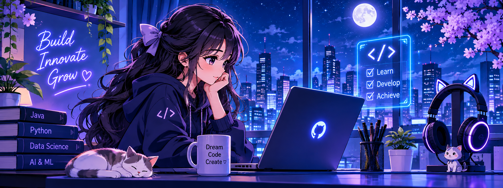

<!-- ========================================= -->
<!-- SHANMUGAPRIYA S - GITHUB PROFILE README -->
<!-- ========================================= -->

<h1 align="center">🌸 SHANMUGAPRIYA S</h1>

  

  

  <i>"Every great creation begins with a curious mind."</i> ✨

  
  
  

---

## 🌷 About Me

Hello! I'm **Shanmugapriya**, a final-year B.Tech student in Artificial Intelligence and Data Science at **Karpagam Institute of Technology, Coimbatore**.

I'm interested in building practical software applications, exploring AI-powered solutions and improving my problem-solving skills.

- 🎓 B.Tech Artificial Intelligence and Data Science (2023–2027)
- 💻 Interested in Software Development and Full-Stack Engineering
- 🤖 Exploring Artificial Intelligence and Data Science
- 🧪 Interested in Software Testing and Automation
- 🌱 Continuously learning and building new projects

---

## ⚡ Tech Universe

### Programming Languages

  

### Frontend & Backend

  

### Database & Developer Tools

  

### Core Concepts

`OOP` · `DBMS` · `Operating Systems` · `Data Structures & Algorithms` · `REST APIs` · `Manual Testing` · `Automation Testing` · `Selenium`

---

## 🎀 Featured Projects

<table>
<tr>
<td width="50%" valign="top">

### 🌸 01. Smart Food-Court Queue System

A full-stack food ordering and queue management application with token generation, role-based authentication and order tracking.

**Technologies**

`Java` `Spring Boot` `React` `MySQL` `JWT`

[✧ Explore Repository](https://github.com/Shqnmugapriya/Food-court-management)

</td>
<td width="50%" valign="top">

### 💜 02. AI-Powered PPT Analyzer

An OCR-based presentation analyzer that extracts slide content and uses Gemini AI to provide suggestions for clarity, organization and missing information.

**Technologies**

`Java` `Spring Boot` `React` `OCR` `Gemini API`

[✧ Explore Repository](https://github.com/Shqnmugapriya/ppt-analyzer)

</td>
</tr>

<tr>
<td width="50%" valign="top">

### 🌙 03. Human Activity Analyzer

A computer vision prototype that identifies sitting, standing and walking activities using human pose landmarks.

**Technologies**

`Python` `OpenCV` `MediaPipe` `Deep Learning`

[✧ Explore Repository](https://github.com/Shqnmugapriya/Human-Activities)

</td>
<td width="50%" valign="top">

### ✨ 04. Field-to-Record

A voice-to-structured clinical note application designed to extract clinical information and organize it into structured records.

**Technologies**

`Python` `Speech Processing` `NLP` `Structured Data`

[✧ Explore Repository](https://github.com/Shqnmugapriya/Field-to-record)

</td>
</tr>
</table>

---

## 🏆 Certifications & Achievements

- Microsoft Azure Fundamentals
- HackerRank SQL — Basic, Intermediate & Advanced
- HackerRank Problem Solving — Basic
- IBM Deep Learning Fundamentals
- freeCodeCamp Responsive Web Design
- NPTEL Computer Vision
- Google Cloud / Simplilearn — Introduction to GenAI Studio

---

## 📊 GitHub Journey

  
  

  

---

## 🌐 Let's Connect

  
  
  

  <i>🌸 Keep learning. Keep creating. Keep moving forward.</i>

<h3 align="center">Thanks for visiting my profile! ✨</h3>

  

